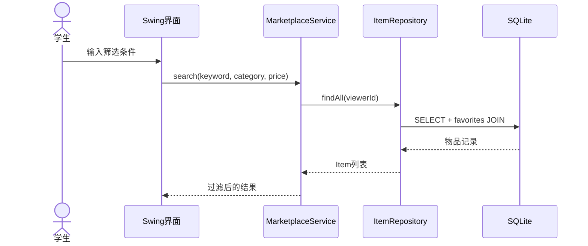
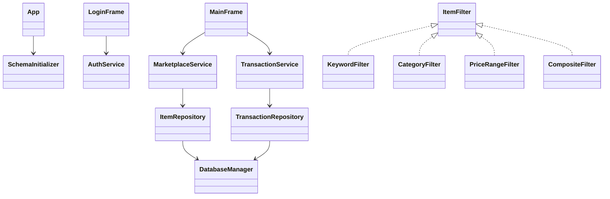

# 首版设计说明

## 分层

Swing `ui` 只处理用户输入和展示；`service` 负责校验、业务规则与事务编排；`repository` 负责 JDBC；`domain` 是不可变领域对象；`config/db` 负责 SQLite 连接和初始化。这样可以让 GUI 与持久化实现解耦，便于后续集成测试和重构。

## 模式落点

1. 单例：`DatabaseManager` 保证连接配置和数据库初始化入口唯一。
2. 工厂：`DaoFactory` 集中构造 `UserRepository`、`ItemRepository`、`TransactionRepository`。
3. 策略：`ItemFilter` 的关键字、分类、价格策略可以组合成 `CompositeFilter`。
4. 观察者：`EventPublisher` 发布登录、发布、流转、评价等事件，由 `AuditLogListener` 记录日志，未来可增加通知监听器。

## 关键时序

## UML 类图（简化）

