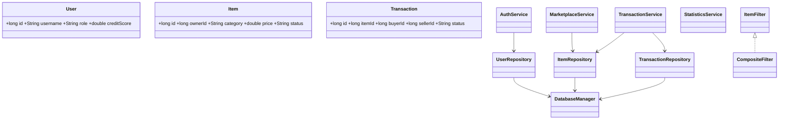
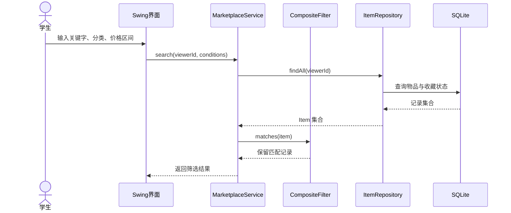

# 低碳校园资源循环流转系统实验报告

## 1 项目概述

本项目面向高校校园中的闲置教材、数码配件、文体用品和生活物资，提供一个可在本地运行的资源循环流转桌面系统。系统使用 Java 17、Swing、JDBC、SQLite 和 Maven 构建，采用分层架构将图形界面、业务规则、数据访问和领域对象分离。用户可以注册登录、发布闲置物品、检索和收藏物品、发起流转、完成交易、互相评价；管理员可以查看用户、下架违规物品并查看全平台统计。

首版交付内容包括可执行 Jar、SQLite 初始化脚本、Maven 源码工程、JUnit 单元测试和集成测试、UML 类图与时序图、部署说明、重构记录和静态分析配置。

## 2 需求分析与角色

| 角色 | 主要用例 |
| --- | --- |
| 普通学生 | 注册、登录、发布物品、修改/下架自己的物品、按条件检索、收藏、发起流转、完成流转、评价、查看统计和导出 CSV |
| 系统管理员 | 登录、查看用户、查看全平台物品、下架违规物品、查看全平台流转统计 |

核心业务闭环为：用户注册/登录 → 发布物品 → 另一用户按条件检索 → 发起流转意向 → 双方完成流转 → 互相评价 → 更新统计与低碳减排估算。

## 3 模块化设计

```text
com.campus.cycle
├── ui             Swing 登录、主窗口、物品广场、流转、统计、管理后台
├── service        Auth、Marketplace、Transaction、Statistics 业务服务
├── repository     JDBC 数据访问和 DaoFactory
├── domain         User、Item、Transaction、Statistics 不可变领域对象
├── filter         关键字、分类、价格和组合筛选策略
├── events         领域事件发布与操作日志监听
├── config/db      SQLite 连接单例、Schema 初始化和种子数据
├── exception      校验、认证、数据访问异常
└── util           密码哈希、日志工具
```

模块之间通过服务层接口协作。GUI 不直接拼接 SQL；Repository 不负责业务校验；Domain 使用 record 表达只读数据，降低共享可变状态导致的错误。

## 4 面向对象与 UML 建模

### 4.1 类图



### 4.2 检索时序图



## 5 数据库设计与持久化

SQLite 数据库包含 `users`、`items`、`favorites`、`transactions`、`ratings` 五张表。用户、物品、流转记录和评价都使用外键关联，收藏使用 `(user_id, item_id)` 联合主键防止重复收藏，评价使用 `(transaction_id, from_user_id)` 唯一约束防止重复评价。

`DatabaseManager` 使用单例模式集中管理 JDBC URL、外键约束和 busy timeout。Repository 层全部使用 `PreparedStatement` 和 try-with-resources，避免 SQL 注入和资源泄漏。启动时 `SchemaInitializer` 读取 `src/main/resources/db/schema.sql`，创建表并写入演示账号。

## 6 设计模式与软件复用

| 模式 | 实现位置 | 使用目的 |
| --- | --- | --- |
| 单例 | `DatabaseManager` | 统一数据库连接配置和初始化入口 |
| 工厂 | `DaoFactory` | 集中创建 Repository，隔离具体构造细节 |
| 策略 | `ItemFilter`、`KeywordFilter`、`CategoryFilter`、`PriceRangeFilter` | 独立封装检索条件并支持组合扩展 |
| 观察者 | `EventPublisher`、`AuditLogListener` | 让登录、发布、流转和评价事件与日志记录解耦 |
| 框架复用 | Maven、SQLite JDBC、JUnit 5、Swing | 复用构建、数据库、测试和桌面 GUI 能力 |

## 7 防御性编程、异常和日志

- 用户名限制为 3-24 位字母、数字或下划线，密码至少 6 位。
- 物品名称、分类、描述、价格、评价分数和价格区间在服务层统一校验。
- 不能对自己的物品发起流转，只有流转参与者才能完成或评价。
- 数据访问异常统一转换为 `DataAccessException`，界面统一显示可理解的提示。
- 密码只保存 SHA-256 摘要，不保存明文密码。
- 关键操作通过观察者事件写入 `data/app.log`，日志失败不会破坏业务主流程。
- JDBC 连接、Statement、ResultSet 使用 try-with-resources 自动释放。

## 8 重构实践

首版开发中识别并处理了以下代码坏味道：

1. 将 GUI 中的业务规则移入 `AuthService`、`MarketplaceService` 和 `TransactionService`，降低界面类的职责数量。
2. 将数据库访问从界面中抽取到 Repository，避免 SQL 与事件监听代码重复。
3. 将多个 if/else 检索条件重构为 `ItemFilter` 策略和 `CompositeFilter`，新增筛选条件时不修改主流程。
4. 将可共享的用户、物品、交易和统计数据重构为 Java record，减少 setter 导致的非法状态。
5. 将日志从业务方法中解耦为 `EventPublisher` + `AuditLogListener`，后续可以加入通知或审计监听器。

具体变更记录见 `docs/REFACTORING_LOG.md`。

## 9 测试方案与结果

| 测试 | 内容 | 结果 |
| --- | --- | --- |
| `PasswordUtilTest` | SHA-256 确定性和非明文校验 | 通过 |
| `FilterTest` | 关键字、分类、价格组合筛选 | 通过 |
| `CoreFlowIntegrationTest` | 真实 SQLite 上注册、登录、发布、检索、发起并完成流转、统计 | 通过 |
| Maven 编译 | Java 17 主源码编译 | 通过 |
| Maven 打包 | Shade 生成包含依赖的可执行 Jar | 通过 |
| PMD 静态分析 | `mvn verify` 生成静态分析报告 | 配置为非阻断检查，报告写入 `target/reports` |

执行命令：

```bash
mvn clean verify
mvn package
java -jar target/campus-cycle-0.1.0.jar
```

## 10 交付与部署

最终交付物：

- `target/campus-cycle-0.1.0.jar`：可直接运行的桌面程序
- `database/schema.sql`：SQLite 初始化脚本
- `src/main/java`：完整 Maven 源码工程
- `src/test/java`：JUnit 单元测试和集成测试
- `docs/ARCHITECTURE.md`：架构和 UML 简图
- `docs/REFACTORING_LOG.md`：重构记录
- `docs/DEPLOYMENT.md`：部署与使用说明

安装 JDK 17 后，在项目根目录执行 `mvn clean verify` 和 `mvn package`。双击 Jar 或执行 `java -jar target/campus-cycle-0.1.0.jar` 启动。首次启动会创建 `data/campus-cycle.db`，演示账号为 `admin/admin123` 和 `demo/123456`。

## 11 迭代计划对齐

当前版本对应第 2-3 次迭代成果：完成核心业务模块、数据库访问、JUnit 测试、Swing GUI 和基础集成。后续第 4 次迭代可以继续补充本地数据备份恢复、图片存储、推荐功能、GUI 截图、完整视频和小组工作记录。
